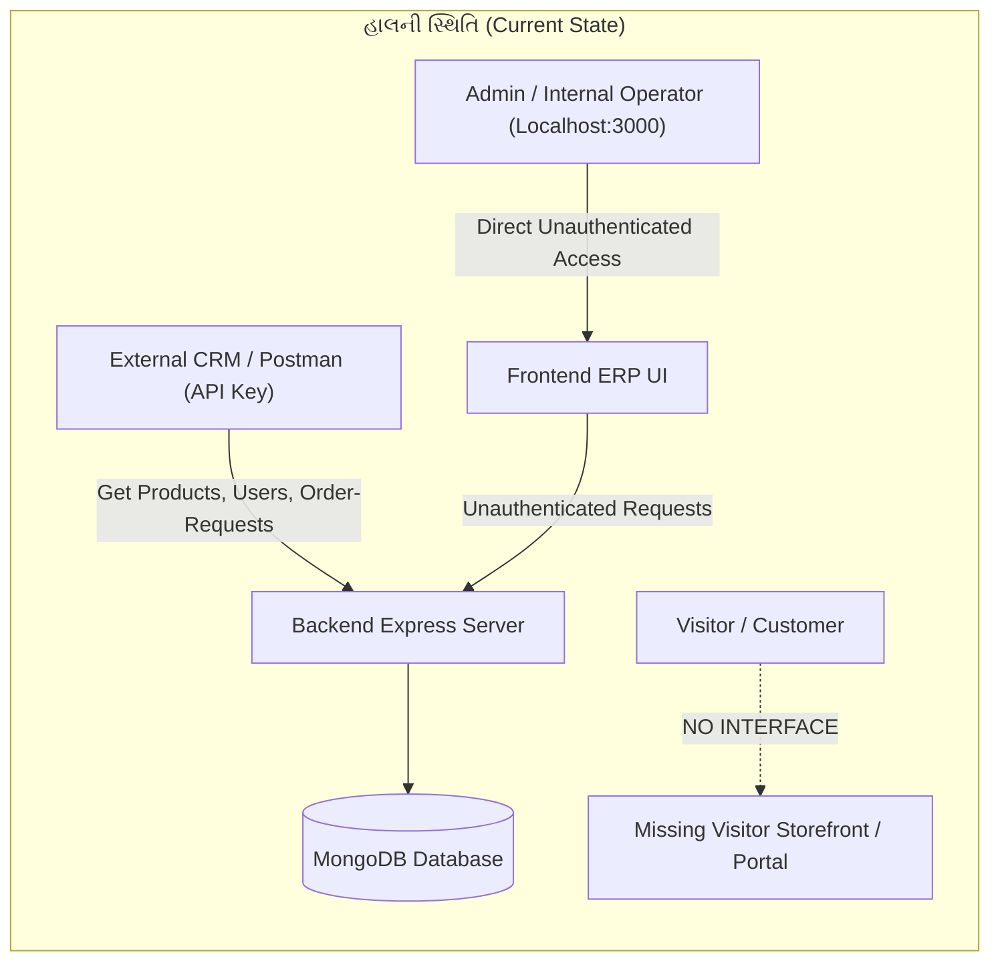

# SENIOR SOFTWARE ARCHITECT & FULL-STACK AUDIT REPORT
**Project:** Danza Son ERP & CRM Integration Platform  
**Target Architecture:** Apparel Manufacturing, Sales & Distribution, Procurement & Inventory  
**Auditor Profile:** Senior Principal Software Architect, Product Lead & QA Expert (20+ Years Real-World Production Experience)  
**Date:** 2026-10-19  
**Status:** Complete Forensic Audit (Strict Read-Only Mode — No Code/DB Alterations Applied)  

---

## 1. EXECUTIVE SUMMARY (સર્વોચ્ચ સારાંશ)

આ રિપોર્ટ Danza Son ERP / CRM સિસ્ટમના સમગ્ર આર્કિટેક્ચર, ડેટાબેઝ ડિઝાઇન, બિઝનેસ લોજિક, યુઝર એક્સપિરિયન્સ (UX), API સિક્યોરિટી અને Visitor vs Admin workflow નું ઊંડાણપૂર્વકનું ઓડિટ છે.

### મુખ્ય તારણો (Key Verdicts):
1. **Visitor Panel સંપૂર્ણપણે ગેરહાજર (Completely Missing):** સિસ્ટમમાં માત્ર ઇન્ટરનલ Admin/ERP ડેશબોર્ડ જ છે. કોઈ પબ્લિક વિઝિટર સ્ટોરફ્રન્ટ, B2B કસ્ટમર પોર્ટલ, સેલ્ફ-રજિસ્ટ્રેશન, કેટલોગ બ્રાઉઝિંગ, કાર્ટ કે ઓનલાઇન ઓર્ડર પ્લેસમેન્ટ મોડ્યુલ ઉપલબ્ધ નથી.
2. **શૂન્ય ઓથેન્ટિકેશન અને ગંભીર સુરક્ષા જોખમ (Zero Auth & Security Flaws):** `/api/v1/sales`, `/api/v1/purchase`, `/api/v1/products` ના તમામ કોર એન્ડપોઇન્ટ્સ સંપૂર્ણપણે અનપ્રોટેક્ટેડ (ઓપન) છે. કોઈ JWT, સેશન કે રોલ-બેઝ્ડ પરમિશન નથી. વધુમાં, External CRM માં મૂકાયેલ `crmAuth` મિડલવેરમાં `Mozilla` યુઝર-એજન્ટ મોકલવાથી ઓથેન્ટિકેશન બાયપાસ થઈ જાય છે.
3. **સ્ટોક અને વેરિઅન્ટ ડિસકનેક્શન (Stock & Variant Invariant Violation):** પ્રોડક્ટ સ્કીમામાં કલર-વાઇઝ વેરિઅન્ટ્સ (`Product.variants`) છે, પરંતુ Sales Order કે GRN પ્રોસેસ કરતી વખતે માત્ર પેરન્ટ પ્રોડક્ટનો `current_stock` અપડેટ થાય છે, વેરિઅન્ટ લેવલનો સ્ટોક ક્યારેય બદલાતો નથી. સ્ટોક નેગેટિવ થવા પર કોઈ ગાર્ડ નથી.
4. **ઓર્ડર કેન્સલેશન / એડિટમાં સ્ટોક રીવર્ઝનનો અભાવ:** જ્યારે સેલ્સ ઓર્ડર કેન્સલ થાય છે ત્યારે બાદ થયેલો સ્ટોક ઇન્વેન્ટરીમાં પાછો જમા (Revert) થતો નથી.
5. **રેસ કન્ડીશન અને ડુપ્લિકેટ સીરિયલ નંબરિંગ:** `SalesOrder`, `SalesInvoice`, `PurchaseOrder`, `PurchaseInvoice` માં સીરિયલ નંબર જનરેશન `countDocuments() + 1` થી થાય છે. કન્કરન્ટ રિક્વેસ્ટમાં ડુપ્લિકેટ નંબર્સ જનરેટ થાય છે, જે GST કાયદા (Rule 46) નું ઉલ્લંઘન છે.
6. **સપ્લાયર અને કસ્ટમર લેજર અસંગતતા:** Purchase Invoice બનવા પર કે પેમેન્ટ થવા પર સપ્લાયરનું `pending_balance` અપડેટ થતું નથી. Purchase Return માં કોઈ ડેબિટ નોટ બનતી નથી.

---

## 2. EXISTING SOFTWARE FLOW OVERVIEW (હાલનો સોફ્ટવેર ફ્લો)

### 2.1 ટેકનિકલ સ્ટેક:
- **Frontend:** React 18, Vite 5, Tailwind CSS, Lucide Icons, Axios, React Router Dom v6.
- **Backend:** Node.js, Express.js (REST API), Morgan, CORS.
- **Database:** MongoDB, Mongoose ODM (embedded MongoMemoryServer ફોલબેક સાથે).
- **External Integration:** REST API collection (`x-api-key` header / Bearer token).

### 2.2 હાલના મોડ્યુલ્સ:
1. **Sales & Distribution:**
   - Customers Directory (`/sales/customers`) & Customer 360° Profile (`/sales/customers/:id`)
   - Products Catalog (`/products`) - કલર વાઇઝ (147 વેરિઅન્ટ્સ) અને સ્ટાઇલ વાઇઝ (9 પ્રોડક્ટ્સ)
   - Sales Quotation / Sales Orders (`/sales/orders`)
   - Sales Tax Invoices (`/sales/invoices`) & Invoice Edit (`/sales/invoices/:id/edit`)
2. **Purchase & Procurement:**
   - Suppliers Directory (`/purchase/suppliers`) & Supplier 360° Profile (`/purchase/suppliers/:id`)
   - Inquiries & Quotations (RFQ) (`/purchase/inquiries`)
   - Purchase Requisitions (PR) (`/purchase/requisitions`)
   - Purchase Orders (PO) (`/purchase/orders`) & PO Detail (`/purchase/orders/:id`)
   - Goods Receipt Notes (GRN) (`/purchase/grn`) & GRN Detail (`/purchase/grn/:id`)
   - Supplier Invoices / Bills (`/purchase/invoices`)
   - Purchase Returns (`/purchase/returns`)
   - Purchase Settings & Categories (`/purchase/settings`)

---

## 3. VISITOR PANEL & ADMIN PANEL RELATIONSHIP AUDIT

### વિઝિટર પેનલ વિશ્લેષણ:
- **સંપૂર્ણ ખાલીપો (Complete Absence):** ગ્રાહક કે વિઝિટર માટે Danza Son ની પ્રોડક્ટ્સ જોવા, સાઈઝ/કલર સિલેક્ટ કરવા, જથ્થાબંધ ઓર્ડર રિક્વેસ્ટ મૂકવા કે પોતાના જૂના ઓર્ડર અને ઇન્વોઇસ જોવા માટે કોઈ જ UI કે પોર્ટલ અસ્તિત્વમાં નથી.
- **એડમિન પર નિર્ભરતા:** દરેક કસ્ટમર એન્ટ્રી અને ઓર્ડર માત્ર એડમિન દ્વારા મેન્યુઅલી જ એન્ટર થઈ શકે છે.
- **ઓર્ડર રિક્વેસ્ટ ડેટા ફ્લો બગ:** External CRM API માં `GET /api/admin/order-request` ઉપલબ્ધ છે, પરંતુ એક્સટર્નલ કસ્ટમર કે વિઝિટર કઈ રીતે ઓર્ડર રિક્વેસ્ટ મૂકી શકે તેનો કોઈ `POST` એન્ડપોઇન્ટ નથી.

---

## 4. DETAILED FINDINGS REPORT (તમામ ક્ષતિઓનું વિગતવાર પત્રક)

| Issue ID | Panel | Module | Issue Type | Current Working | Problem | Impact | Recommended Flow | Priority | File Reference | Evidence |
|---|---|---|---|---|---|---|---|---|---|---|
| **ISS-001** | Visitor | Customer Portal | Architecture | સિસ્ટમમાં માત્ર એડમિન ERP UI છે. | કોઈ Visitor / B2B Customer Portal નથી. | ગ્રાહક ઓનલાઇન કેટલોગ જોઈ શકતો નથી કે ઓર્ડર મૂકી શકતો નથી. | પબ્લિક સ્ટોરફ્રન્ટ / B2B પોર્ટલ બનાવો જ્યાં ગ્રાહક કલર/સાઇઝ વાઇઝ કેટલોગ જોઈને ઇન્ક્વાયરી/ઓર્ડર મૂકી શકે. | **Critical** | `frontend/src/App.jsx` | `App.jsx` માં માત્ર એડમિન લેઆઉટ જ માઉન્ટ થયેલ છે. |
| **ISS-002** | Both | Auth & Security | Security | `/api/v1/sales`, `/purchase`, `/products` ઓપન છે. | કોઈ JWT કે સેશન ઓથેન્ટિકેશન નથી. | કોઈ પણ વ્યક્તિ યુઆરએલ દ્વારા ડેટા ડિલીટ કે મોડિફાય કરી શકે છે. | JWT બેઝ્ડ રોલ-બેઝ્ડ ઓથેન્ટિકેશન (RBAC: Admin, Manager, Sales, Customer) લાગુ કરો. | **Critical** | `backend/src/app.js` | `app.js` લાઇન 37-39: કોઈ ઓથ મિડલવેર વગર રાઉટ્સ માઉન્ટ કરેલા છે. |
| **ISS-003** | Admin | CRM Auth Bypass | Security | `crmAuth.js` માં `req.headers['user-agent']?.includes('Mozilla')` છે. | બ્રાઉઝર યુઝર-એજન્ટ મોકલવાથી API કી વગર API એક્સેસ થઈ જાય છે. | સિક્યોરિટી સંપૂર્ણ બાયપાસ થઈ જાય છે; કોઈ પણ હેકર કી વગર CRM API વાપરી શકે છે. | યુઝર-એજન્ટ આધારિત બાયપાસ કાઢી નાખો; માત્ર માન્ય API કી અથવા સિક્યોર સેશન અલાઉ કરો. | **Critical** | `backend/src/middleware/crmAuth.js` | Lines 30-38: `isInternal` માં `Mozilla` યુઝર-એજન્ટ ચેક. |
| **ISS-004** | Admin | Sales & Inventory | Logic | Sales Order બનતાં `Product.current_stock` માંથી જથ્થો બાદ થાય છે. | કલર વેરિઅન્ટ (`variants.stock`) અપડેટ થતો નથી. | પેરન્ટ સ્ટોક ઘટે પણ કલર વેરિઅન્ટનો સ્ટોક એવો ને એવો રહે, સ્ટોક મિસમેચ થાય. | ઓર્ડર આઇટમ સાથે વેરિઅન્ટ આઈડી લિંક કરી ચોક્કસ કલર વેરિઅન્ટનો સ્ટોક બાદ કરવો. | **Critical** | `backend/src/controllers/salesController.js` | Lines 317-323: `Product.findByIdAndUpdate` માત્ર પેરન્ટ પર `$inc` કરે છે. |
| **ISS-005** | Admin | Inventory Control | Logic | સેલ્સ ઓર્ડરમાં સ્ટોક ઓછો હોય તો પણ ઓર્ડર સેવ થઈ જાય છે. | નેગેટિવ સ્ટોક સામે કોઈ ગાર્ડ નથી. | સ્ટોક -5, -20 થઈ જાય છે (Overselling). ફેક્ટરીમાં માલ ન હોવા છતાં ઓર્ડર બને છે. | ડેટાબેઝ લેવલે ચેક કરો: `current_stock: { $gte: item.quantity }`. અપૂરતા સ્ટોકે એરર આપો. | **High** | `backend/src/controllers/salesController.js` | Line 320: કોઈ કન્ડીશન વગર સીધું નેગેટિવ `$inc`. |
| **ISS-006** | Admin | Sales Order Lifecycle | Flow / Logic | સેલ્સ ઓર્ડર કેન્સલ થાય (`status: cancelled`) ત્યારે સ્ટોક એવો ને એવો રહે છે. | કેન્સલ થયેલા ઓર્ડરનો સ્ટોક ઇન્વેન્ટરીમાં પાછો જમા થતો નથી. | એકવાર ઓર્ડર બન્યા પછી કેન્સલ થાય તો પણ કંપનીનો સ્ટોક ખોટી રીતે ઓછો બતાવે છે. | `updateSalesOrderStatus` માં જો સ્ટેટસ `cancelled` થાય તો તમામ આઇટમ્સનો સ્ટોક રીસ્ટોર કરવો. | **Critical** | `backend/src/controllers/salesController.js` | Lines 339-357: સ્ટેટસ અપડેટ થાય છે પણ સ્ટોક રીવર્સલ કોડ ગેરહાજર છે. |
| **ISS-007** | Admin | Order & Invoice Numbering | Architecture | `countDocuments() + 1` થી SO અને Invoice નંબર બને છે. | કન્કરન્ટ રિક્વેસ્ટમાં રેસ કન્ડીશન સર્જાય છે. | બે ઓર્ડર કે બિલને એક જ નંબર મળી જાય છે; GST કાયદા મુજબ ડુપ્લિકેટ બિલિંગ ગેરકાયદે છે. | એટોમિક કાઉન્ટર કલેક્શન (`findAndModify`) અથવા ડેડિકેટેડ સીક્વન્સર વાપરો. | **Critical** | `backend/src/models/SalesOrder.js`, `SalesInvoice.js` | `SalesOrder.js` lines 168-175 & `SalesInvoice.js` lines 157-164. |
| **ISS-008** | Admin | GST & Taxation | Logic | `customer.billing_address.state === 'Gujarat'` હાર્ડકોડેડ છે. | વેરહાઉસ રાજ્ય કે શિપિંગ રાજ્ય ધ્યાને લેવાતું નથી. | મુંબઈ વેરહાઉસમાંથી ગુજરાત માલ જાય તો IGST ને બદલે ખોટો CGST/SGST ગણાય છે. | Dispatch Warehouse State vs Shipping State ની સરખામણી કરી ટેક્સ સ્પ્લિટ કરવો. | **High** | `backend/src/controllers/salesController.js` | Lines 499-514 & lines 599-631: હાર્ડકોડેડ ગુજરાત ચેક. |
| **ISS-009** | Admin | Procurement Ledger | Logic | Purchase Invoice બનવા પર સપ્લાયરનું `pending_balance` વધતું નથી. | ખરીદીનું બિલ બનવા છતાં સપ્લાયરનું બાકી લેણું શૂન્ય રહે છે. | એકાઉન્ટિંગ ખોટું પડે છે; કંપનીએ વેપારીને કેટલા ચૂકવવાના છે તે ખબર પડતી નથી. | `createInvoice` વખતે સપ્લાયરનું `pending_balance` બિલની રકમ જેટલું વધારવું. | **Critical** | `backend/src/controllers/purchaseController.js` | Lines 804-822: માત્ર ઇન્વોઇસ સેવ થાય છે, સપ્લાયરમાં કોઈ `$inc` નથી. |
| **ISS-010** | Admin | Procurement Payments | Architecture | સપ્લાયર બિલના પેમેન્ટ્સ `remarks` માં સ્ટ્રિંગ તરીકે કન્કેટ થાય છે. | પેમેન્ટનું કોઈ સ્ટ્રક્ચર્ડ લેજર ટેબલ નથી. | ઓડિટ કે પાર્શિયલ પેમેન્ટ વખતે કઈ તારીખે કયા મોડથી કેટલા ચૂકવ્યા તે ફિલ્ટર થતું નથી. | `PurchaseInvoice` માં `payments: [{ amount, date, mode, ref }]` સબડોક્યુમેન્ટ ઉમેરો. | **High** | `backend/src/controllers/purchaseController.js` | Lines 938-943: `remarks = remarks + paymentNote`. |
| **ISS-011** | Admin | Purchase Returns | Logic | પરત કરેલા માલની રકમ સપ્લાયર બેલેન્સમાંથી બાદ થતી નથી. | ડેબિટ નોટ બનતી નથી કે લેણું ઘટતું નથી. | ખરાબ માલ પરત મોકલવા છતાં સપ્લાયરને પૂરા નાણાં ચૂકવાઈ જવાનું જોખમ રહે છે. | Purchase Return સાથે ડેબિટ નોટ જનરેટ કરી સપ્લાયરનું લેણું ઘટાડવું. | **High** | `backend/src/controllers/purchaseController.js` | Lines 998-1028: માત્ર સ્ટોક બાદ થાય છે, એકાઉન્ટ્સ અનટચ્ડ છે. |
| **ISS-012** | Admin | Customer Management | Flow | ગ્રાહક ડિલીટ કરતાં કોઈ પેન્ડિંગ બેલેન્સ ચેક થતું નથી. | ₹50,000 બાકી હોય તેવા ગ્રાહકને પણ ડિલીટ કરી શકાય છે. | કંપનીનું બાકી લેણું સિસ્ટમમાંથી ગુમ થઈ જાય છે અને રીપોર્ટિંગ ખોટું પડે છે. | જો `pending_balance > 0` હોય કે એક્ટિવ ઓર્ડર હોય તો ડિલીટ બ્લોક કરો. | **High** | `backend/src/controllers/salesController.js` | Lines 160-172: સીધું `is_deleted: true` કરી દેવામાં આવે છે. |
| **ISS-013** | Admin | Database & Performance | Performance | GRN અને બિલોની ફાઇલો Base64 સ્ટ્રિંગ સ્વરૂપે MongoDB માં સેવ થાય છે. | 16MB ડોક્યુમેન્ટ લિમિટ અને નેટવર્ક સ્લોડાઉન થાય છે. | થોડા મહિનામાં ડેટાબેઝ ફૂલી જશે અને ક્વેરીઓ ટાઈમઆઉટ થઈ જશે. | ફાઇલો લોકલ `/uploads` ફોલ્ડરમાં કે AWS S3 પર મૂકી DB માં માત્ર URL સ્ટોર કરો. | **High** | `backend/src/models/GoodsReceiptNote.js` | `file_data: { type: String }` માં Base64 સ્ટોરેજ. |
| **ISS-014** | Admin | UI Terminology | UX | સાઇડબારમાં "Sales Quotation" લખ્યું છે પરંતુ અંદર "Sales Order" બને છે. | વપરાશકર્તા માટે ક્વોટેશન અને પાકા ઓર્ડર વચ્ચે ભ્રમ ઊભો થાય છે. | ક્વોટેશન આપવાનું હોય ત્યાં સીધો ઓર્ડર બની સ્ટોક કપાઈ જાય છે. | Quotation અને Sales Order બંનેના અલગ સ્ટેજ અને પેજ રાખો (Quotation -> Approval -> Order). | **Medium** | `frontend/src/components/layout/Sidebar.jsx` & `SalesOrders.jsx` | Sidebar લાઇન 22 & SalesOrders.jsx હેડર. |
| **ISS-015** | Admin | Code Quality | Architecture | `procurementService.js` માં `ft`, `St`, `Dt` જેવા મિનિફાઇડ નામો એક્સપોર્ટ છે. | કોડ વાંચવામાં અને ડીબગ કરવામાં મુશ્કેલી પડે છે. | ભવિષ્યમાં નવા ડેવલપર માટે કોડ મેન્ટેન કરવો જોખમી બને છે. | અર્થપૂર્ણ નામો વાપરો: `purchaseApi`, `warehouseApi`, `productApi`. | **Low** | `frontend/src/services/procurementService.js` | Lines 19, 68, 80: `ft`, `St`, `Dt`. |

---

## 5. BUSINESS LOGIC & WORKFLOW ANALYSIS

### 5.1 હાલનો સેલ્સ ફ્લો vs આદર્શ ફ્લો (Current vs Recommended Sales Flow):

```mermaid
flowchart TD
    subgraph Current_Flawed_Flow["હાલનો ખામીયુક્ત ફ્લો (Current Flawed Flow)"]
        A1[Customer Entry] --> A2[Sales Order / Quotation Form]
        A2 -->|Stock Deducted Immediately| A3[Sales Order Confirmed]
        A3 -->|Cancel Order| A4[Status: Cancelled - Stock Lost Forever]
        A3 -->|Generate Invoice| A5[Sales Invoice Created]
        A5 --> A6[Customer Pending Balance Increased]
    end

    subgraph Recommended_Production_Flow["આદર્શ પ્રોડક્શન ફ્લો (Recommended Enterprise Flow)"]
        B1[Customer / Lead Profile] --> B2[Sales Quotation / RFQ]
        B2 -->|Customer Approves| B3[Sales Order Confirmed]
        B3 -->|Reserve Variant Stock| B4[Stock Allocated / Reserved]
        B4 -->|Cancel Order| B4Cancel[Cancel Order - Stock Unreserved Automatically]
        B4 --> B5[Warehouse Picklist & Delivery Challan Dispatch]
        B5 -->|Physical Dispatch| B6[Stock Deducted from Specific Variant]
        B6 --> B7[GST Tax Invoice Generated]
        B7 --> B8[Payment Settlement via Bank/Cash Ledger]
    end
```

### 5.2 હાલનો પર્ચેઝ ફ્લો vs આદર્શ ફ્લો (Purchase & Procurement Flow):

```mermaid
flowchart TD
    subgraph Current_Purchase_Flow["હાલનો પર્ચેઝ ફ્લો"]
        P1[Inquiry / RFQ] --> P2[Purchase Requisition PR]
        P2 --> P3[Purchase Order PO]
        P3 --> P4[GRN Received]
        P4 -->|Manual Button| P5[Post to Stock - Parent Stock Only]
        P5 --> P6[Purchase Invoice Recorded]
        P6 -.->|Supplier Balance NOT Updated| P7[Supplier Balance Frozen]
    end

    subgraph Recommended_Purchase_Flow["આદર્શ પર્ચેઝ ફ્લો"]
        R1[Material Requirement / Requisition PR] --> R2[Multi-Supplier Inquiry & Quotation Comparison]
        R2 -->|Approve Best Rate| R3[Purchase Order PO Sent to Vendor]
        R3 --> R4[Gate Entry & Physical Inspection]
        R4 --> R5[GRN Verification: Accepted / Rejected Qty]
        R5 -->|Automatic Posting| R6[Stock Incremented for Specific Color/Size Variants]
        R6 --> R7[Vendor Bill Booking with 3-Way Matching: PO vs GRN vs Bill]
        R7 --> R8[Supplier Pending Balance Incremented in Accounts Ledger]
        R8 --> R9[Payment Voucher Settlement]
    end
```

---

## 6. REAL-WORLD SCENARIO TESTING (વાસ્તવિક પરિસ્થિતિઓમાં નિષ્ફળતાનું જોખમ)

1. **સિનિયર સિનેરિયો 1: બે યુઝર્સ એક સાથે ઓર્ડર આપે ત્યારે (Concurrency & High Traffic)**
   - **પરિણામ:** બંને ઓર્ડર `SalesOrder.countDocuments()` કરશે અને બંનેને સમાન નંબર (દા.ત. `SO-2026-00010`) ફાળવાશે. ડેટાબેઝમાં `unique` ઇન્ડેક્સ ન હોવાથી બંને સેવ થશે. GST ઓડિટમાં ડુપ્લિકેટ ઇન્વોઇસ બદલ ભારે દંડ થઈ શકે છે.
2. **સિનિયર સિનેરિયો 2: ગ્રાહક ઓર્ડર કેન્સલ કરે ત્યારે (Order Cancellation)**
   - **પરિણામ:** એડમિન ઓર્ડરનું સ્ટેટસ "Cancelled" કરશે, પરંતુ પ્રોડક્ટનો સ્ટોક રિવર્સ થતો નથી. ફેક્ટરીમાં 100 ટી-શર્ટ હાજર હોવા છતાં સિસ્ટમ 80 બતાવશે અને નવો ઓર્ડર લેવાની ના પાડશે.
3. **સિનિયર સિનેરિયો 3: મુંબઈ ગોડાઉનમાંથી સુરતના ગ્રાહકને ડિલિવરી (Inter-State Supply)**
   - **પરિણામ:** સિસ્ટમ માત્ર કસ્ટમરનું સ્ટેટ જોશે અને "Gujarat" મળતાં CGST (9%) + SGST (9%) ફાડી આપશે. ખરેખર મહારાષ્ટ્રથી ગુજરાત માલ જતો હોવાથી IGST (18%) લાગવો જોઈએ. આ ગંભીર ટેક્સ કમ્પલાયન્સ ખામી છે.
4. **સિનિયર સિનેરિયો 4: ખરાબ માલ સપ્લાયરને પરત મોકલવો (Purchase Return)**
   - **પરિણામ:** સ્ટોકમાંથી માલ કપાઈ જશે, પણ સપ્લાયરને ચૂકવવાપાત્ર રકમ ઘટશે નહીં. એકાઉન્ટન્ટ ભૂલથી સપ્લાયરને પૂરા નાણાં ચૂકવી દેશે.
5. **સિનિયર સિનેરિયો 5: બાકી રકમવાળા કસ્ટમરનું ડિલીશન**
   - **પરિણામ:** ₹1,00,000 બાકી હોય તેવા કસ્ટમરને ડિલીટ કરતાં તે લિસ્ટમાંથી ગાયબ થઈ જશે અને તેનું બેલેન્સ અટવાઈ જશે.

---

## 7. PRIORITY-WISE IMPROVEMENT ROADMAP (સુધારા માટેનો પ્રાથમિકતા રોડમેપ)

### Phase 1: સુરક્ષા અને ડેટા ઇન્ટેગ્રિટી (તાત્કાલિક - અતિ મહત્વનું)
- તમામ કોર ERP API (`/sales`, `/purchase`, `/products`) પર JWT ઓથેન્ટિકેશન લાગુ કરો.
- `crmAuth.js` માંથી `Mozilla` યુઝર-એજન્ટ બાયપાસ દૂર કરો.
- `SalesOrder`, `SalesInvoice`, `PurchaseOrder`, `PurchaseInvoice` માં એટોમિક સીક્વન્સર અને `unique` ઇન્ડેક્સ મૂકો.
- સેલ્સ ઓર્ડર કેન્સલ થાય ત્યારે સ્ટોક રિવર્સલ લોજિક ઉમેરો.
- નેગેટિવ સ્ટોક સામે ડેટાબેઝ કન્સ્ટ્રેઇન્ટ લગાવો.

### Phase 2: એકાઉન્ટિંગ અને ઇન્વેન્ટરી સાતત્ય (બીજો તબક્કો)
- સેલ્સ અને પર્ચેઝ બંનેમાં કલર-વાઇઝ વેરિઅન્ટ લેવલનો સ્ટોક અપડેટ કરો.
- Purchase Invoice બનતાં સપ્લાયરનું `pending_balance` અપડેટ કરો.
- Purchase Return સાથે ડેબિટ નોટ જનરેટ કરી સપ્લાયર લેજર એડજસ્ટ કરો.
- વેરહાઉસ રાજ્ય vs ડિલિવરી રાજ્ય મુજબ ડાયનેમિક GST (CGST/SGST vs IGST) ગણતરી કરો.
- Base64 ફાઇલો DB માંથી હટાવી ફાઇલ સિસ્ટમ / S3 સ્ટોરેજ લાગુ કરો.

### Phase 3: વિઝિટર પોર્ટલ અને યુઝર એક્સપિરિયન્સ (ત્રીજો તબક્કો)
- **Visitor / B2B Ordering Storefront:** ગ્રાહકો પોતાની રીતે લોગિન કરી કલર/સાઇઝ વાઇઝ કેટલોગ જોઈને ઇન્ક્વાયરી કે બલ્ક ઓર્ડર મૂકી શકે તેવું પબ્લિક પેનલ તૈયાર કરો.
- Quotation અને Sales Order વચ્ચેનો ભેદ સ્પષ્ટ કરો (Quotation Approval Workflow).
- `procurementService.js` માંથી મિનિફાઇડ એક્સપોર્ટ્સ દૂર કરી ક્લીન મોડ્યુલર સર્વિસ બનાવો.

---

## 8. FINAL PRODUCTION READINESS ASSESSMENT

| પાસું (Dimension) | હાલનું રેટિંગ (1-10) | સ્ટેટસ | ટિપ્પણી |
|---|---|---|---|
| **UI Design & Aesthetics** | **8.5 / 10** | ✅ મજબૂત | ટેબલ્સ, કલર સ્વોચિસ, પોપિન્સ ફોન્ટ અને ક્લીન મોડલ્સ આકર્ષક છે. |
| **Code Modularity** | **7.0 / 10** | ⚠️ મધ્યમ | કંટ્રોલર્સ અને મોડલ્સ યોગ્ય રીતે વહેંચાયેલા છે પણ મિનિફાઇડ એલિયસ છે. |
| **Business Logic Integrity** | **3.5 / 10** | ❌ જોખમી | સ્ટોક વેરિઅન્ટ અપડેટ થતો નથી, ઓર્ડર કેન્સલેશનમાં સ્ટોક પાછો આવતો નથી. |
| **Accounting & Tax Accuracy**| **4.0 / 10** | ❌ જોખમી | સપ્લાયર બેલેન્સ અપડેટ થતું નથી, GST રાજ્ય લોજિક હાર્ડકોડેડ છે. |
| **Security & Authentication** | **2.0 / 10** | ❌ અત્યંત જોખમી | કોર રૂટ્સ પર કોઈ ઓથેન્ટિકેશન નથી, CRM ઓથ બાયપાસ સરળ છે. |
| **Overall Commercial Readiness**| **3.5 / 10** | ❌ Not Ready | વ્યવસાયિક ઉપયોગ કે ગ્રાહક લોન્ચિંગ પહેલાં ઉપરોક્ત સુધારાઓ અનિવાર્ય છે. |

---
*Report Generated By: Senior Software Architect & Full-Stack Audit Engine (Antigravity)*
